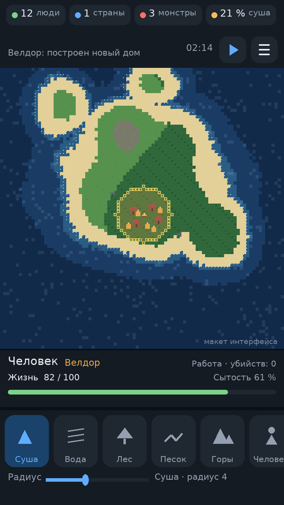

# WorldGod

**2D-симулятор бога для Android и десктопа, целиком на Rust.** Океан → кисть суши → человек, который валит лес, строит дома и основывает страну → волки и зомби, которые охотятся на людей.

Никакой Java-обёртки в проекте нет вообще: Android запускает нативную библиотеку через `NativeActivity`, а весь интерфейс нарисован на `egui` в стиле системного Android-приложения. Никакой сборки мусора, никакой виртуальной машины — только скомпилированный код.

[](https://github.com/ehekufa/WorldGod/actions/workflows/ci.yml)
[](https://github.com/ehekufa/WorldGod/actions/workflows/build-apk.yml)
[](LICENSE)



*На картинке — **макет** интерфейса: компоновка панелей и палитра из `theme.rs`.
Настоящие кадры игры делает `worldgod_preview` тем же рендером, что и в приложении
(см. [«Скриншоты без GPU»](#скриншоты-без-gpu)).*

---

## Содержание

- [Как играть](#как-играть)
- [Управление](#управление)
- [Структура проекта](#структура-проекта)
- [Быстрый старт: десктоп](#быстрый-старт-десктоп)
- [Скриншоты без GPU](#скриншоты-без-gpu)
- [Сборка APK](#сборка-apk)
- [Что внутри](#что-внутри)
- [Технические решения](#технические-решения)
- [Тесты](#тесты)
- [Что дальше](#что-дальше)
- [Лицензия](#лицензия)

---

## Как играть

Порядок этапов — это и есть обучение: каждый следующий шаг открывается предыдущим.

### 1. Океан

Мир рождается пустым: только вода, лёгкие волны и глубина по краям. Суши нет ни одного тайла — это видно в счётчике «суша 0 %».

### 2. Кисть суши

Выберите инструмент **«Суша»** и проведите пальцем по воде. Под кистью поднимается земля: сначала мелководье, потом пляж, потом трава. Ползунок «Радиус» (1…14) задаёт размер мазка.

Тут же рядом:

| Инструмент     | Что делает                                                        |
| -------------- | ----------------------------------------------------------------- |
| **Суша**       | поднимает рельеф из воды (основная кисть)                          |
| **Вода**       | опускает сушу обратно в океан                                      |
| **Лес**        | заливает землю лесом — источник дерева и еды                       |
| **Песок**      | делает пляж                                                        |
| **Горы**       | поднимает неприступный хребет (по нему нельзя ходить)              |

### 3. Человек → дом → страна

Поставьте **человечка** на траву. Дальше он живёт сам:

1. рубит лес и носит дерево;
2. когда дерева достаточно (2 единицы) — **основывает страну**: ставит костёр-столицу, получает имя и цвет;
3. копит дерево на дом (3 единицы) и **закладывает фундамент**; другие жители помогают достраивать;
4. готовый дом поднимает лимит населения — рождаются новые жители, иногда воины;
5. голод гонит людей к лесу за едой, а старость и раны медленно их забирают.

Вокруг столицы и домов на карте проявляется **территория страны** — цветная подсветка с границей.

### 4. Мобы

| Существо   | Поведение                                                             |
| ---------- | --------------------------------------------------------------------- |
| **Волк**   | стайный хищник: ищет людей и оленей в радиусе 8                        |
| **Зомби**  | медленный, живучий; убив человека, с шансом 60 % поднимает нового зомби |
| **Олень**  | мирная добыча, убегает от волка                                        |
| **Воин**   | сам атакует монстров в радиусе 9, прикрывает мирных жителей            |

Мирные жители убегают от хищника, если рядом нет защитника. Волки и зомби, убив человека, оставляют запись в ленте событий — она видна в верхней панели.

### 5. Дальше

Этот список — дорожная карта, а не обещание: см. [«Что дальше»](#что-дальше).

---

## Управление

**Телефон / планшет**

| Жест                  | Действие                                  |
| --------------------- | ----------------------------------------- |
| Один палец            | применить выбранную кисть                 |
| Два пальца (сдвиг)    | панорама карты                            |
| Два пальца (щипок)    | зум от 0.55× до 64×                       |
| Тап по инструменту    | выбрать кисть                             |

**Компьютер**

| Ввод                        | Действие                        |
| --------------------------- | ------------------------------- |
| ЛКМ                         | кисть                           |
| ПКМ / СКМ                   | панорама                        |
| Колесо / трекпад            | зум / прокрутка                 |
| `Space`                     | пауза                           |
| `1`…`9`                     | быстрый выбор инструмента       |
| `Esc`                       | снять выделение с существа      |
| `Home`                      | вписать карту в окно            |

Инструмент **«Осмотр»** выбирает существо: появляется карточка с видом, страной, здоровьем, сытостью, намерением и числом убийств.

---

## Структура проекта

```
WorldGod/
├── Cargo.toml                  # workspace: версия, профили, общие зависимости
├── rust-toolchain.toml         # стабильный тулчейн (MSRV 1.81)
├── Agent.md                    # исходное задание
├── crates/
│   ├── worldgod_core/          # логика мира — без единой внешней зависимости
│   │   └── src/
│   │       ├── lib.rs          # публичный API и документация
│   │       ├── grid.rs         # TilePos, радиусы, соседи
│   │       ├── math.rs         # Vec2, интерполяция, цветовые утилиты
│   │       ├── rng.rs          # детерминированный ГПСЧ (splitmix64)
│   │       ├── noise.rs        # value-noise для рельефа
│   │       ├── terrain.rs      # виды рельефа, пороги высот, цвета-константы
│   │       ├── world.rs        # тайлы, высота/влажность, вода и суша
│   │       ├── brush.rs        # кисти: рельеф, спавн существ
│   │       ├── camera.rs       # вид: центр, масштаб, экран↔тайл
│   │       ├── entity.rs       # существо и его намерения
│   │       ├── species.rs      # характеристики видов
│   │       ├── building.rs     # костёр, дом, руины, стройка
│   │       ├── nation.rs       # страны, палитра, население
│   │       ├── pathfind.rs     # A* с бюджетом + жадный шаг
│   │       ├── ai.rs           # «мозги»: голод, стройка, охота, паника
│   │       ├── combat.rs       # удары, смерть, заражение зомби
│   │       ├── events.rs       # лента событий
│   │       ├── names.rs        # генератор названий стран
│   │       └── sim.rs          # Simulation: тик, заселение, территории
│   ├── worldgod_render/        # программный рендер в RGBA (работает без GPU)
│   │   └── src/
│   │       ├── lib.rs
│   │       ├── framebuffer.rs  # кадр, линии, прямоугольники, альфа
│   │       ├── png.rs          # PNG-энкодер без зависимостей
│   │       ├── palette.rs      # цвета воды, земли, существ
│   │       ├── terrain_pass.rs # тайлы, тени рельефа, волны, границы
│   │       ├── sprite.rs       # пиксельные спрайты из символьных «артов»
│   │       └── scene.rs        # сборка кадра: рельеф → постройки → существа
│   ├── worldgod_app/           # приложение eframe/egui (десктоп + Android)
│   │   ├── Cargo.toml          # + метаданные APK для cargo-apk
│   │   ├── assets/fonts/       # DejaVu Sans (кириллица) + лицензия
│   │   ├── res/mipmap-*/       # иконки приложения
│   │   └── src/
│   │       ├── main.rs         # десктопная точка входа
│   │       ├── android.rs      # точка входа Android (android_main)
│   │       ├── lib.rs          # сборка крейта, run_desktop
│   │       ├── app.rs          # кадр приложения, панели, горячие клавиши
│   │       ├── state.rs        # состояние: мир, камера, кисть, FPS
│   │       ├── textures.rs     # мир → текстура egui с троттлингом
│   │       ├── map_view.rs     # карта, жесты, курсор кисти
│   │       ├── theme.rs        # цвета, шрифты, «нативная» плотность
│   │       ├── ui_icons.rs     # векторные иконки, нарисованные кодом
│   │       └── hud/            # верхняя панель, лоток, инспектор, настройки
│   └── worldgod_preview/       # генератор PNG-скриншотов (без окна и GPU)
│       └── src/main.rs
├── tools/
│   ├── make_icons.py           # пересборка иконок APK
│   └── make_mockup.py          # макет интерфейса для README
├── scripts/build_android.sh    # локальная сборка APK
├── docs/
│   ├── ARCHITECTURE.md         # подробности внутреннего устройства
│   └── mockup-ui.png           # макет интерфейса (иллюстрация)
└── .github/workflows/
    ├── build-apk.yml           # автоматическая сборка .apk
    └── ci.yml                  # тесты, clippy, скриншоты сцен
```

---

## Быстрый старт: десктоп

```bash
# нужен Rust 1.81+ (https://rustup.rs)
cargo run --release -p worldgod_app --bin worldgod
```

На Linux понадобятся библиотеки окна:

```bash
sudo apt-get install -y libxkbcommon-dev libwayland-dev libx11-dev \
    libxcursor-dev libxrandr-dev libxi-dev libgl1-mesa-dev
```

---

## Скриншоты без GPU

`worldgod_preview` собирает четыре детерминированные сцены и сохраняет их в PNG —
полезно для README, для проверки рендера в CI и просто чтобы посмотреть мир без окна:

```bash
cargo run --release -p worldgod_preview -- --out docs --px 4
# docs/preview-1-ocean.png     — пустой океан
# docs/preview-2-island.png    — остров с лесом и людьми
# docs/preview-3-nation.png    — государство после 3600 тиков
# docs/preview-4-monsters.png  — нашествие волков и зомби
```

Файлы `docs/preview-*.png` генерируются заново и не хранятся в репозитории; в CI они
складываются в артефакт **worldgod-previews**.

---

## Сборка APK

### Вариант 1: GitHub Actions (ничего не нужно устанавливать)

1. Запушьте ветку в GitHub.
2. Откройте **Actions → Android APK → Run workflow** (или просто сделайте push в `main`).
3. Скачайте артефакт **worldgod-apk** — внутри готовый `worldgod.apk`.

Собираются три ABI (`arm64-v8a`, `armeabi-v7a`, `x86_64`) в один APK, поэтому он
запускается и на телефоне, и на эмуляторе. Для pull request дополнительно собирается
быстрая arm64-версия.

Установка:

```bash
adb install -r worldgod.apk
```

### Вариант 2: локально

Нужны Android SDK, NDK и `cargo-apk` (Java — только для `apksigner`, который лежит в SDK):

```bash
cargo install cargo-apk --locked
export ANDROID_HOME="$HOME/Android/Sdk"
export ANDROID_NDK_HOME="$HOME/Android/Sdk/ndk/27.0.12077973"

scripts/build_android.sh                          # все ABI
scripts/build_android.sh aarch64-linux-android    # только arm64 — быстрее
```

APK появится в `target/release/apk/`. Параметры упаковки (имя пакета, SDK, иконка, тема)
описаны прямо в `crates/worldgod_app/Cargo.toml` в секциях
`[package.metadata.android]` — отдельный `AndroidManifest.xml` и Gradle-проект не нужны.

---

## Что внутри

### Ядро (`worldgod_core`)

* **Мир** — сетка тайлов с высотой 0…1000 и влажностью; рельеф выводится из них
  (`terrain_at`), поэтому одна и та же кисть даёт берег, луг, лес и горы.
* **Симуляция** — фиксированный шаг: 10 тиков в секунду. Один тик: мышление → шаг →
  бой → экономика → итоги. Движение с интерполяцией между тиками, поэтому картинка
  плавная даже при 10 Гц логики.
* **Размышления** — каждое существо думает раз в 6–13 тиков со сдвигом по фазе:
  сначала угроза, потом голод, потом работа по стране. Так симуляция не «дёргается»
  и не тратит ресурсы впустую.
* **Страны** — костёр-столица, дома, население, лимит жилья, территории (заливка
  радиусом 9 от столицы и 4 от дома), имя и цвет из палитры.
* **Пути** — A* с бюджетом раскрытий (1500) и жадный шаг как запасной вариант;
  если пути нет — существо ждёт, а не телепортируется.
* **Детерминизм** — один и тот же `seed` при одном и том же вводе даёт один и тот же
  мир. Это используется в тестах и в генераторе скриншотов.

### Рендер (`worldgod_render`)

Пиксельный рендер в обычный RGBA-буфер: рельеф с освещением с северо-запада, «дышащая»
вода, пена у берега, границы стран, спрайты существ и построек, подсветка выбранного.
PNG пишется собственным энкодером (без `flate2` и без зависимостей) — на выходе тот же
буфер, что уходит в текстуру GPU.

### Приложение (`worldgod_app`)

* Мир рисуется один раз в текстуру `3 px/тайл` (`TextureOptions::NEAREST`) и
  обновляется не чаще 30 раз в секунду (8 раз в секунду на паузе); панорама и зум —
  это UV-кроп той же текстуры, поэтому кадры дешёвые.
* Интерфейс: верхняя панель с чипами статистики, лента событий, кнопки скорости и
  настроек; внизу — лоток инструментов с ползунком радиуса; над ним — карточка
  выбранного существа; окно настроек с размерами мира, справкой и версией.
* Тема — тёмная, «системная»: панели `#151B23`, акцент `#60ACFF`, скругления 12,
  DejaVu Sans с полной кириллицей (шрифт вшит в бинарник, поэтому APK работает
  офлайн и без системных шрифтов).

### Скриншоты (`worldgod_preview`)

Отдельный бинарник без GUI: строит сцены через то же ядро и тот же рендер, что и игра,
и сохраняет PNG. Работает в CI и в контейнерах без дисплея.

---

## Технические решения

| Требование из `Agent.md`            | Как выполнено                                                              |
| ----------------------------------- | -------------------------------------------------------------------------- |
| Только Rust / C / C++, без GC и VM  | 100 % Rust, `#![forbid(unsafe_code)]` в приложении; allocation — только `Vec` |
| Java — максимум минимальная обёртка | Java нет совсем: `NativeActivity` + `android_main` в `cdylib`               |
| UI на Rust в нативном стиле         | `egui`/`eframe` 0.31, собственная тема в духе Material: панели, чипы, скругления |
| Готовый `.yml` для сборки APK       | `.github/workflows/build-apk.yml` (cargo-apk + NDK + SDK)                   |
| Рабочий код                         | 4 крейта, 42 файла и ~9 100 строк, юнит-тесты на логику, рендер и интерфейс            |

Отдельно про отсутствие Java: `cargo-apk` собирает `cdylib` под Android и упаковывает
её в APK с `android.app.NativeActivity`. `winit` создаёт окно из нативной активности,
`eframe` поднимает GL-контекст, `egui` рисует интерфейс. Ни Gradle, ни `AndroidManifest.xml`,
ни единого `.java`-файла в проекте нет.

---

## Тесты

```bash
cargo test -p worldgod_core           # симуляция, экономика, бои, пути
cargo test -p worldgod_render         # кадры, PNG, спрайты, границы
cargo test -p worldgod_app            # интерфейс, состояние, жесты, тема
cargo test -p worldgod_preview        # сцены и аргументы командной строки
cargo test --workspace                # всё сразу
```

Тесты интерфейса поднимают `egui::Context` без окна, поэтому идут в headless-CI.
Сценарные тесты ядра проверяют, что люди действительно основывают страну, строят дома,
а волки и зомби действительно убивают людей.

---

## Что дальше

Логичные следующие шаги (каждый — небольшой и локальный):

* сохранение и загрузка мира (версия движка для формата уже есть — `ENGINE_VERSION`);
* стихийные бедствия: метеорит, пожар, чума, наводнение;
* боги-покровители и религия: страны воюют друг с другом, а не только с монстрами;
* вода как ресурс: колодцы, реки, засуха;
* больше построек: ферма, стена, башня, порт;
* достижения и статистика партии в отдельном экране.

---

## Лицензия

MIT — см. [LICENSE](LICENSE). Шрифт DejaVu Sans распространяется по своей лицензии
(см. `crates/worldgod_app/assets/fonts/LICENSE-DejaVu.txt`).
